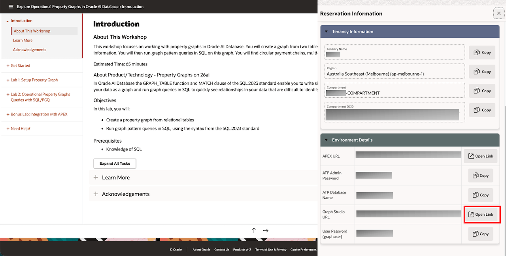
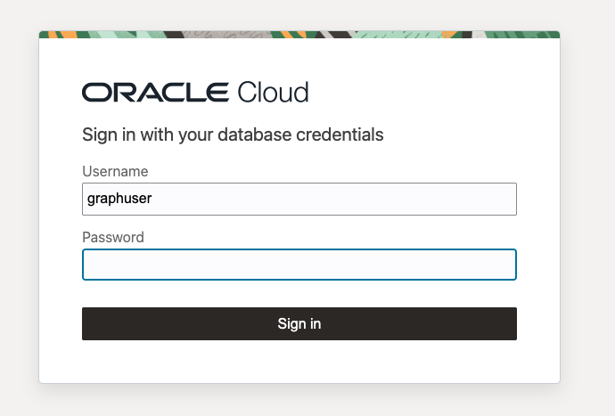
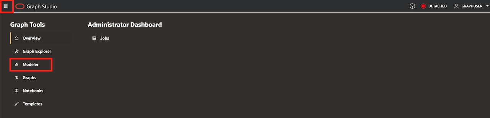
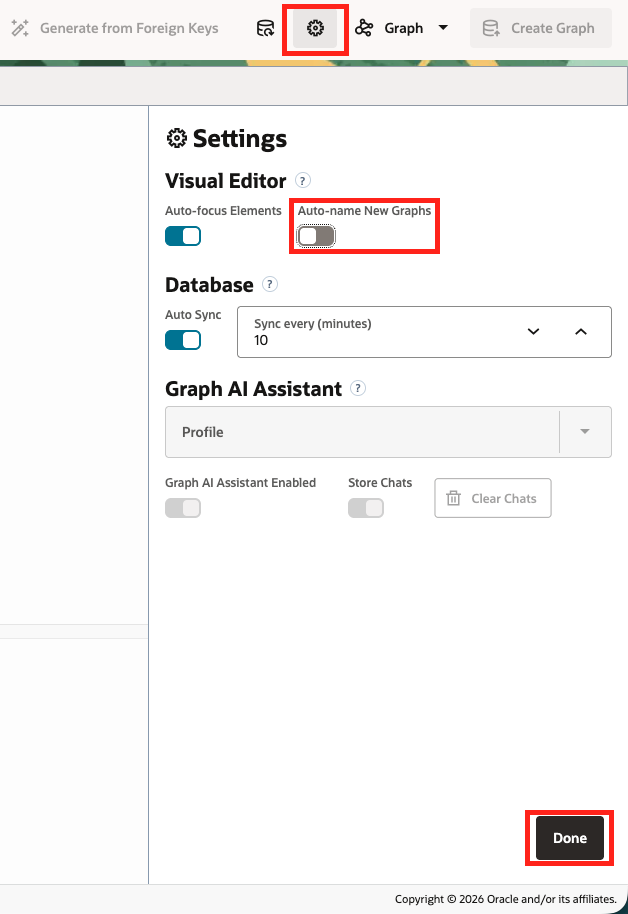
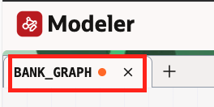
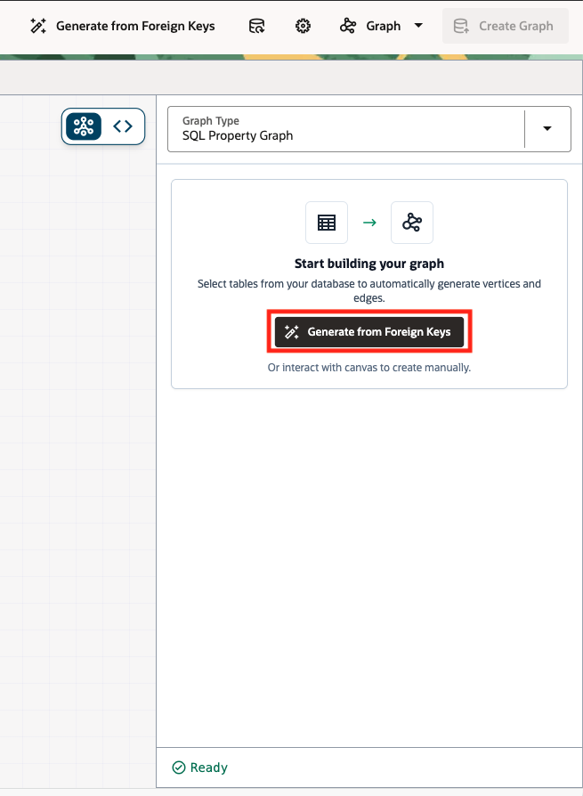
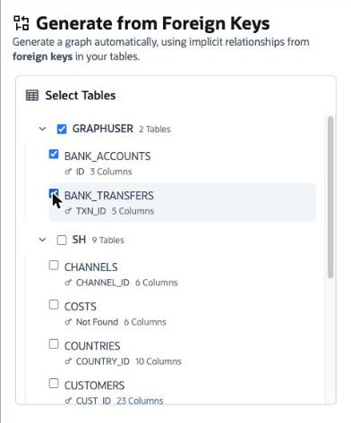
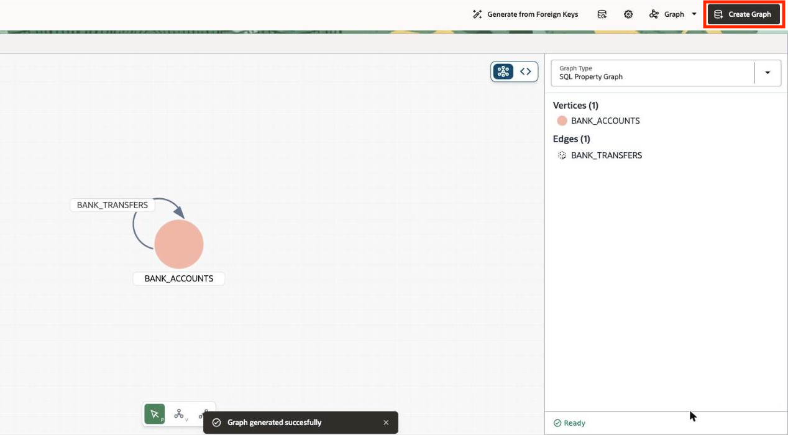
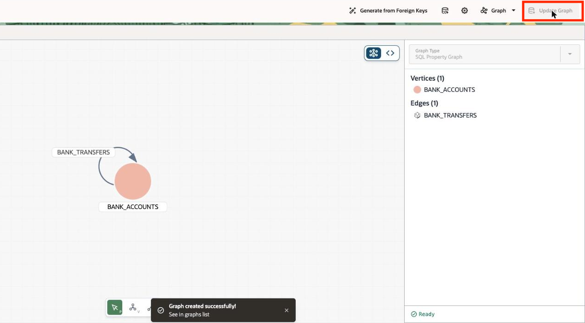
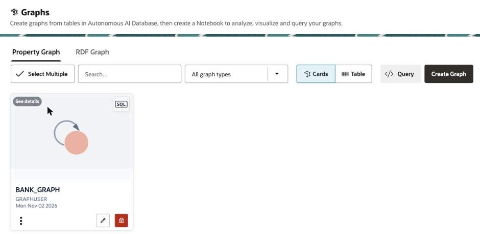

# Setup

## Introduction

You will be creating an Operational Property Graph inside of Graph Studio, one of the applications that's available in Autonomous AI Database.

Estimated Time: 10 minutes

### Objectives

In this lab, you will:

* Open up Graph Studio
* Create an Operational Property Graph

### Prerequisites

This lab assumes you have:

* Access to an Oracle Autonomous AI Database

<!-- <if type="livelabs">
Watch the video below for a quick walk-through of the lab. The lab instructions on the left might not match the workshop you are currently in, but the steps in the terminal on the right remain the same.
[Change password](videohub:1_x4hgmc2i)
</if> -->

## Task 1: Setup materials

1. Click [this link](https://objectstorage.us-ashburn-1.oraclecloud.com/p/J3-_Q3MMvb_J03-lN4o-eDtcJP0nGQC1OQaQkh3OUXab69VaXJuI1KSa8ZsB2vE1/n/oradbclouducm/b/OperationalPropertyGraphs/o/26ai-property-graph.zip) to download the zip file with our property graph setup materials.

2. Unzip the files. You should see these files available.

    

3. Here is a diagram representing the tables that will underlying the Operational Property Graph that we will be creating.

    | Name | Null? | Type |
    | ------- |:--------:| --------------:|
    | ID | NOT NULL | NUMBER|
    | NAME |  | VARCHAR2(4000) |
    | BALANCE |  | NUMBER |
    {: title="BANK_ACCOUNTS"}

    | Name | Null? | Type |
    | ------- |:--------:| --------------:|
    | TXN_ID | NOT NULL | NUMBER|
    | SRC\_ACCT\_ID |  | NUMBER |
    | DST\_ACCT\_ID |  | NUMBER |
    | DESCRIPTION |  | VARCHAR2(4000) |
    | AMOUNT |  | NUMBER |
    {: title="BANK_TRANSFERS"}

## Task 2: Load data from files

You begin by loading data for bank accounts and bank transfers from CSV files.

1. Sign out of Admin and sign into your graph user account.
    

2. In Database Actions, click the main hamburger icon at the top left, and then select SQL.

    

3. Click Data Load in the top right corner

    

4. Drag and drop the 2 .csv files (bank_accounts.csv and bank_transfers.csv) into the data load page.

    

5. Click Upload

    

6. Then click Close

    

7. Copy and paste the contents of the file CreateKeys.sql into the worksheet. Click **Run Script**.

    

## Task 3: Create the Property Graph

1. Click **View Login Info** on your LiveLabs reservation.

    

2. Under **Environment Details**, click the Graph Studio URL.

    

3. Sign into Graph Studio as `graphuser` with the reservation's graphuser password.

    

4. Open **Navigation** and choose **Modeler**.

    

5. In **Settings**, turn off **Auto-name New Graphs** if it is on. This lets you use the name required by the next lab.

    

6. Click **New Graph**.

7. The graph tab, `UNTITLED`, is ready for input so enter `bank_graph`, and press **Enter**. Graph Studio displays the name as `BANK_GRAPH`.

    

8. Click **Generate from Foreign Keys**.

    

9. Under `GRAPHUSER`, select only `BANK_ACCOUNTS` and `BANK_TRANSFERS`, then click **Generate**.

    

10. Confirm the model shows one vertex table, `BANK_ACCOUNTS`, and one edge table, `BANK_TRANSFERS`.

    

11. Click **Create Graph** once. Wait until the graph is ready; the button changes to **Update Graph**.

    

12. Open **Navigation**, choose **Graphs**, and confirm that `BANK_GRAPH` appears with owner `GRAPHUSER`.

    

You may now proceed to the next lab.

## Learn More

* [Introducing Oracle AI Database 26ai: Next-Gen AI-Native Database for All Your Data](https://blogs.oracle.com/database/post/oracle-announces-oracle-ai-database-26ai)

## Acknowledgements

* **Author** - Kaylien Phan, William Masdon
* **Contributors** - David Start, Renée Wikestad
* **Last Updated By/Date** - Denise Myrick, November 2026
